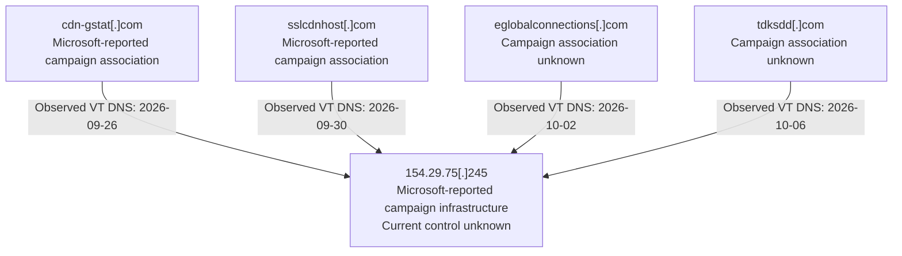

# Cloud Identity Infrastructure: APT29-Associated Domain Investigation

**Status:** Review copy  
**Audience:** SOC and threat intelligence analysts  
**Research session:** November 7, 2026, EST; recorded UTC lookups extend into November 8  
**Intelligence requirement:** Starting from one domain, how much of the group's current infrastructure can we identify, and what should we watch or block?

## Key findings

Passive research corroborated historical infrastructure associated with Microsoft's CaptiveCrunch reporting. VirusTotal records link the seed, `cdn-gstat[.]com`, and a second Microsoft-reported domain, `sslcdnhost[.]com`, to `154.29.75[.]245` during September 2026. Two other domains appeared at the same IP in early October, but the reviewed evidence does not establish their campaign membership or common ownership. [M1] [V1] [V2]

The evidence supports a historical SOC hunt for the reported indicators. It does not establish current actor control, justify unconditional blocking of the shared IP, or support attributing every neighboring domain to APT29. No usable JARM or JA4X data was obtained.

## Scope and evidence handling

The investigation began with a domain listed in Microsoft's October 5, 2026 update. The campaign attribution is Microsoft's assessment; this investigation examines infrastructure relationships rather than independently establishing actor identity. No previously unknown APT29 infrastructure is claimed.

Research used ICANN Lookup, crt.sh, VirusTotal, Shodan, and the unauthenticated Censys host view. Only existing third-party records were consulted. No direct visits, probes, or new scans of suspect infrastructure were performed.

“Observed” means displayed in the reviewed source, not independently measured on the network. “Inferred” identifies analytical interpretation. Unknown campaign relationships remain explicitly unknown. Observation dates, certificate validity, registration dates, and lookup times are kept separate.

## Infrastructure map



**Sources:** VirusTotal domain and IP relations [V1] [V2] [V3] [V4]; campaign labels from Microsoft [M1]. Solid edges represent individual recorded DNS observations, not simultaneous or continuous hosting. These edges do not establish ownership. Retrieval times for these individual DNS observations were not recorded.

## Investigation results

### Registration

ICANN Lookup reported the seed's registrar as Dynadot LLC, creation on September 16, 2026 at 09:22:50 UTC, and nameservers `ns1.dyna-ns[.]net` and `ns2.dyna-ns[.]net`. Contact details were redacted. Retrieval: November 7 at 23:38 UTC. [R1]

Earlier certificate and DNS records exist for the same name in 2020–2021. The displayed 2026 creation date does not describe the name's entire history. Separate registration periods are possible, but continuity of control, deletion, and re-registration were not established.

### Certificates

| Domain / record | SANs | Not Before (UTC) | Not After (UTC) | Finding |
| --- | --- | --- | --- | --- |
| Seed, crt.sh 29486103058 | `*.cdn-gstat[.]com`, `cdn-gstat[.]com` | 2026-09-17 06:17:11 UTC | 2026-12-16 06:17:10 UTC | Wildcard certificate; no concrete additional hostname |
| Seed, VT historical certificate | `cdn-gstat[.]com` | 2026-09-21 11:17:16 | 2026-12-20 11:17:15 | Separate certificate record, VT first seen September 26 |
| sslcdnhost, crt.sh 29919480284 | `sslcdnhost[.]com` | 2026-09-30 07:36:34 UTC | 2026-12-29 07:36:33 UTC | No cross-domain SAN connection |
| eglobalconnections, VT | `eglobalconnections[.]com` | 2026-10-01 06:47:56 | 2026-12-30 06:47:55 | No additional SAN lead |
| tdksdd, VT | `tdksdd[.]com` | 2026-10-05 06:00:03 | 2027-01-03 06:00:02 | No additional SAN lead |

Certificate validity start is not treated as issuance, deployment, or observed service availability. [C1] [C2] [V1] [V3] [V4]

The reviewed records did not establish a shared certificate or cross-domain SAN. The two candidate certificates had different public-key bytes despite using the same EC algorithm. Common Let's Encrypt issuers and algorithms were not considered distinctive linkage evidence.

The seed certificate's SHA-256 was `88E30C456B7A26C2044E053EDE2DE1DB5F8EB006EE81A9324813E288C3A98A9A`. The sslcdnhost certificate's SHA-256 was `1E154F7EA569455CAC8D8AD4CFD229EB101A82F37615DAC880645176B3019B95`. The seed record contained embedded SCTs; no poison extension was found. [C1] [C2]

### Passive DNS and campaign context

| Domain | Recorded resolution to shared IP | Campaign assessment |
| --- | --- | --- |
| `cdn-gstat[.]com` | September 26, 2026 | Microsoft-reported association |
| `sslcdnhost[.]com` | September 30, 2026 | Microsoft-reported association |
| `eglobalconnections[.]com` | October 2, 2026 | Unconfirmed candidate |
| `tdksdd[.]com` | October 6, 2026 | Unconfirmed candidate |

Microsoft separately lists the seed domain first seen September 30 and the IP September 29. Those dates reflect its visibility; the earlier VT dates are not silently replaced. Individual observations do not supply full activity intervals. [M1] [V1] [V2]

The seed also had records for `185.53.179[.]128`, `1.1.1[.]1`, and a 2020 address. Their roles were not established as campaign infrastructure. The appearance of a public resolver address does not establish actor control or justify blocking it. Older addresses were not attributed to the 2026 operator.

### Candidate evaluation

The two unconfirmed candidates shared Internet Domain Service BS Corp. as registrar, Whois Privacy Corp. contact details, and three topdns nameservers in the reviewed October snapshots. Their recorded creation dates were October 1 and October 5 respectively, preceding shared-IP observations on the following days. Older domain history was also present. [V3] [V4]

**Assessment:** The timing warrants investigation, but the registration fields may reflect bundled services. Matching privacy-related values do not identify a common operator. Shared or reassigned hosting remains an alternative explanation. Neither candidate is added to the confirmed campaign indicator set.

Both candidate certificates' validity starts precede their recorded creation timestamps by less than an hour. Validity start alone does not establish issuance time, so the sequence remains unresolved.

### Server and fingerprint visibility

Shodan returned no results for the IP query. Censys displayed AS397423, Tier.Net Technologies LLC, a Dallas geolocation estimate, and zero services in the accessible view. Scan history required login. These fields describe provider visibility and network context, not attacker identity or historical service availability. [S1] [S2]

No JARM or JA4X values were available. Consequently, no fingerprint pivot or fingerprint-based relationship is claimed. Missing results do not prove that the infrastructure was inactive or benign.

## SOC recommendations

1. **Hunt historical telemetry:** Search September–October 2026 DNS, proxy, firewall, and endpoint network records for the two Microsoft-reported domains and the shared IP. Correlate hits with device, user, initiating process, and surrounding authentication events.
2. **Investigate, rather than assume compromise:** A DNS lookup or connection can arise for multiple reasons. Prioritize context, follow-on activity, and incident evidence.
3. **Keep candidates separate:** Search for the two unconfirmed domains as secondary leads. Do not attribute or block them solely from shared-IP and registration-service similarities.
4. **Validate before current blocking:** Establish present status, indicator role, business impact, and policy fit. Historical actor associations do not establish present ownership. Do not block `1.1.1[.]1` on this evidence.

These are proposed actions; no organizational telemetry was examined or detection logic tested.

## Limitations and stopping decision

- Only 10 of 54 IP relation entries and 10 of 16 tdksdd resolution entries were supplied for review.
- Several crt.sh detail requests returned HTTP 502; certificate comparisons remain incomplete.
- Shodan lacked results, Censys history required authentication, and fingerprint pivots were unavailable.
- Some individual query URLs and retrieval timestamps were not preserved; missing times remain unrecorded.
- Candidate ownership, current activity, and continuous hosting intervals are unknown.
- Source-reported infrastructure was corroborated, not independently attributed. Privacy services and shared hosting can create false associations.

The investigation stopped after establishing the principal dated DNS edges, evaluating two neighboring domains, and identifying the limits of accessible certificate and scan records. The evidence supports historical hunting while leaving current infrastructure coverage incomplete.

## Query and retrieval record

| Service | Lookup | Retrieval time UTC | Outcome |
| --- | --- | --- | --- |
| ICANN Lookup | `cdn-gstat.com` | 2026-11-07 23:38 | Registration record |
| crt.sh | Seed-domain certificate search and detail records | Not recorded | Records obtained; two detail requests repeatedly failed |
| crt.sh | `%.sslcdnhost.com` | 2026-11-08 00:44 | Certificate listing; detail record subsequently examined |
| VirusTotal | Seed domain / shared IP Relations | Not recorded | Dated resolution edges and neighboring domains |
| VirusTotal | `eglobalconnections.com` | 2026-11-08 01:01 | DNS, WHOIS, and certificate summaries |
| VirusTotal | `tdksdd.com` and candidate detail records | Not recorded | DNS, WHOIS, and certificate evidence |
| Shodan | `154.29.75.245` | Not recorded | No results |
| Censys | `154.29.75.245` | Not recorded | Host summary; history access restricted |

Exact submitted certificate-search requests were not captured. The supplied results links used base-domain query parameters. Lookup times are reported in UTC; missing retrieval times remain unrecorded.

## Appendix: proposed KQL hunting queries

**Validation status:** Proposed hunts, not executed or validated against organizational telemetry. They are not production detection rules.

**Data requirement:** Microsoft Defender for Endpoint network events in `DeviceNetworkEvents`, available through Defender advanced hunting or a suitably configured Sentinel-connected environment. The queries use `Timestamp`, `RemoteUrl`, `RemoteIP`, device identifiers, and initiating-process fields from the documented schema. [K1]

**Historical availability:** The window is September 1 through October 31, 2026, UTC, with an exclusive November 1 upper bound. Standard Defender advanced hunting exposes 30 days of data; this full window requires previously retained data, such as supported tables streamed to Sentinel with sufficient retention. Adjust the portal time selector as well as query dates. Changing dates cannot recover expired telemetry. [K2]

### Hunt 1: source-reported infrastructure

Matches exact domain names, their subdomains, or the reported IP. Hostname parsing handles URLs and bare hostnames, normalizes case, and removes a trailing dot. Dot-delimited suffix matching avoids matching lookalike names such as `notcdn-gstat[.]com`. Subdomains are included for coverage, not individually asserted as malicious.

```kusto
// Proposed historical hunt; not validated against tenant telemetry.
let HuntStart = datetime(2026-09-01);
let HuntEnd = datetime(2026-11-01); // Exclusive: covers September and October UTC.
let Seed = replace_string("cdn-gstat[.]com", "[.]", ".");
let Related = replace_string("sslcdnhost[.]com", "[.]", ".");
let ReportedIP = replace_string("154.29.75[.]245", "[.]", ".");
DeviceNetworkEvents
| where Timestamp >= HuntStart and Timestamp < HuntEnd
| extend UrlText = tolower(trim(@"\s+", tostring(RemoteUrl)))
| extend RemoteHost = tostring(parse_url(
    iff(UrlText contains "://", UrlText, strcat("https://", UrlText))
    ).Host)
| extend RemoteHost = trim_end(@"\.+", RemoteHost)
| extend DomainMatch = RemoteHost == Seed
    or RemoteHost endswith strcat(".", Seed)
    or RemoteHost == Related
    or RemoteHost endswith strcat(".", Related)
| extend IPMatch = RemoteIP == ReportedIP
| where DomainMatch or IPMatch
| extend MatchBasis = case(
    DomainMatch and IPMatch, "Reported domain and IP",
    DomainMatch, "Reported domain or subdomain",
    "Reported IP only: check hosting context")
| project Timestamp, DeviceName, DeviceId, ActionType, MatchBasis,
    RemoteHost, RemoteUrl, RemoteIP, RemotePort,
    InitiatingProcessAccountDomain, InitiatingProcessAccountName,
    InitiatingProcessFileName, InitiatingProcessCommandLine, ReportId
| order by Timestamp desc
```

An IP-only hit has weaker attribution value because hosting can be shared or reassigned. Review its timestamp and destination context. Domain hits also require investigation; no action type is assumed to prove a successful connection.

### Hunt 2: unconfirmed neighboring domains

This query deliberately excludes IP-only matches. It separates candidate-domain activity from reported campaign indicators and supports contextual review rather than automatic attribution or blocking.

```kusto
// Unconfirmed candidates: hits do not establish campaign membership.
let HuntStart = datetime(2026-09-01);
let HuntEnd = datetime(2026-11-01);
let CandidateA = replace_string("eglobalconnections[.]com", "[.]", ".");
let CandidateB = replace_string("tdksdd[.]com", "[.]", ".");
DeviceNetworkEvents
| where Timestamp >= HuntStart and Timestamp < HuntEnd
| extend UrlText = tolower(trim(@"\s+", tostring(RemoteUrl)))
| extend RemoteHost = tostring(parse_url(
    iff(UrlText contains "://", UrlText, strcat("https://", UrlText))
    ).Host)
| extend RemoteHost = trim_end(@"\.+", RemoteHost)
| where RemoteHost == CandidateA
    or RemoteHost endswith strcat(".", CandidateA)
    or RemoteHost == CandidateB
    or RemoteHost endswith strcat(".", CandidateB)
| extend MatchBasis = "Unconfirmed candidate domain or subdomain"
| project Timestamp, DeviceName, DeviceId, ActionType, MatchBasis,
    RemoteHost, RemoteUrl, RemoteIP, RemotePort,
    InitiatingProcessAccountDomain, InitiatingProcessAccountName,
    InitiatingProcessFileName, InitiatingProcessCommandLine, ReportId
| order by Timestamp desc
```

### Triage and coverage limits

For each result, validate the destination and event time, then review the device, initiating process, account context, and related endpoint and identity activity. The initiating-process account may be a service or system identity rather than the interactive user. Security tools, sandboxes, and legitimate research can generate matches.

`DeviceNetworkEvents` is not a complete DNS or proxy log. Empty `RemoteUrl` values, malformed names, missing endpoint coverage, proxies, retention limits, and result truncation can affect findings. The first query can still match the reported IP when a hostname is absent; the candidate query cannot. No results do not establish absence of contact or compromise. Validate against authorized positive and negative sample events and available tenant data before operational use.


## Method disclosure

The researcher performed the lookups and supplied results for analysis. This report uses public data; no employer information or private incident telemetry was used.

## Sources

[M1]: https://www.microsoft.com/en-us/security/blog/2026/07/31/captivecrunch-midnight-blizzard-targets-travelers-worldwide-for-malware-delivery-and-credential-theft/
[V1]: https://www.virustotal.com/gui/domain/cdn-gstat.com/relations
[V2]: https://www.virustotal.com/gui/ip-address/154.29.75.245/relations
[V3]: https://www.virustotal.com/gui/domain/eglobalconnections.com/relations
[V4]: https://www.virustotal.com/gui/domain/tdksdd.com/relations
[C1]: https://crt.sh/?id=29486103058
[C2]: https://crt.sh/?id=29919480284
[R1]: https://lookup.icann.org/
[S1]: https://www.shodan.io/
[S2]: https://platform.censys.io/

- [M1] Microsoft Threat Intelligence, CaptiveCrunch report, July 31, 2026; October 5 update.
- [V1] VirusTotal seed-domain Relations.
- [V2] VirusTotal shared-IP Relations.
- [V3] VirusTotal eglobalconnections Relations and historical records.
- [V4] VirusTotal tdksdd Relations and historical records.
- [C1] crt.sh seed wildcard certificate record.
- [C2] crt.sh sslcdnhost certificate record.
- [R1] ICANN Lookup registration result supplied by the researcher.
- [S1] Shodan existing host search.
- [S2] Censys unauthenticated host summary supplied as a screenshot.


[K1]: https://learn.microsoft.com/en-us/defender-xdr/advanced-hunting-devicenetworkevents-table
[K2]: https://learn.microsoft.com/en-us/defender-xdr/advanced-hunting-overview

- [K1] Microsoft Learn, DeviceNetworkEvents schema.
- [K2] Microsoft Learn, Advanced hunting overview and historical retention.

