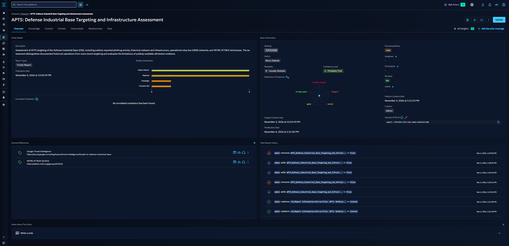
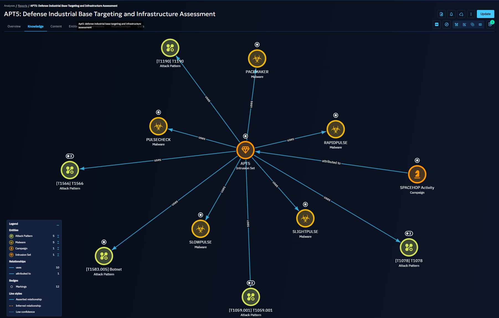
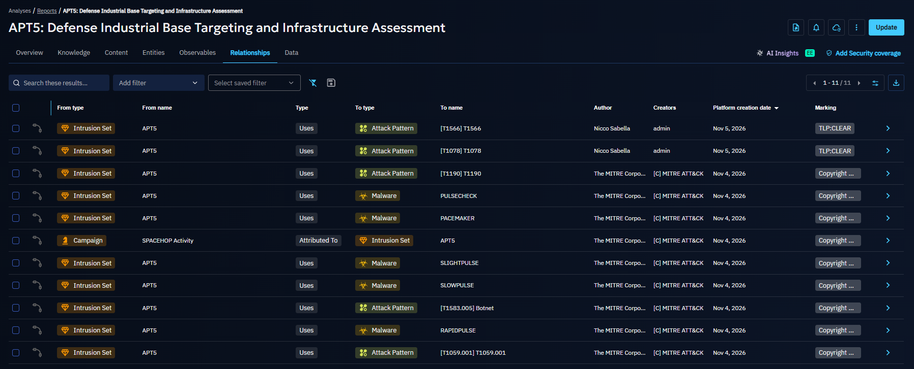

# APT5 Threat Intelligence Assessment

## Overview
This project presents an independent Cyber Threat Intelligence (CTI) assessment of APT5, a China-linked threat actor associated with cyber espionage operations.

The assessment focuses on APT5's targeting of the Defense Industrial Base (DIB), historical infrastructure, operational techniques, and attribution challenges.

## Research Objectives
- Examine APT5's targeting of defense and aerospace organizations.
- Analyze historical infrastructure and operational methods.
- Map documented activity to the MITRE ATT&CK framework.
- Evaluate attribution evidence and analytical confidence.
- Distinguish historical operations from recently reported targeting activity.

## Full Intelligence Report

The complete assessment is available in two formats:

- [Read Full Assessment on GitHub](./assessment.md)
- [View PDF Intelligence Report](./APT5-Intelligence-Report.pdf)

## OpenCTI Research Documentation

The following screenshots show how I organized and documented publicly reported APT5 intelligence using OpenCTI.

### Intelligence Report Overview

The report overview documents the assessment, source references, analytical confidence, and associated intelligence entities.

### Threat Intelligence Knowledge Graph

The knowledge graph visualizes documented relationships between APT5, MITRE ATT&CK techniques, historical malware families, and SPACEHOP Activity.

These relationships represent publicly reported historical associations and should not be interpreted as evidence linking the 2024–2025 DIB phishing campaigns to historical infrastructure.

### Intelligence Relationships

The relationships table documents 11 associations involving attack patterns, malware, and historical campaign activity. These include relationships imported from MITRE ATT&CK and relationships added during my research.

The assessment distinguishes historical reporting from recent targeting activity and identifies attribution limitations.

## Research Tools
- OpenCTI
- MISP
- MITRE ATT&CK
- Public threat intelligence reporting

## Methodology
This assessment uses publicly available intelligence, structured threat actor research, and MITRE ATT&CK mapping. Findings distinguish confirmed reporting from analytical judgments and identify intelligence gaps where evidence is insufficient.

## Disclaimer
This report represents independent research for educational and professional development purposes. It does not represent an official intelligence assessment from any employer or government organization.
